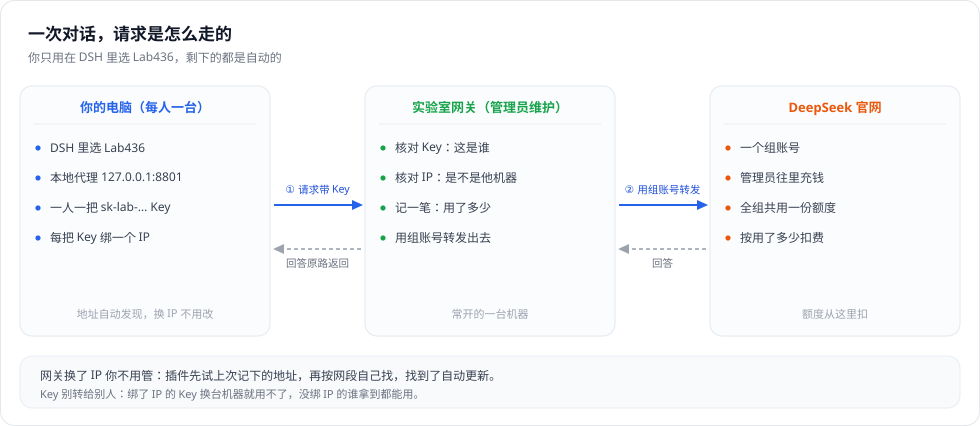
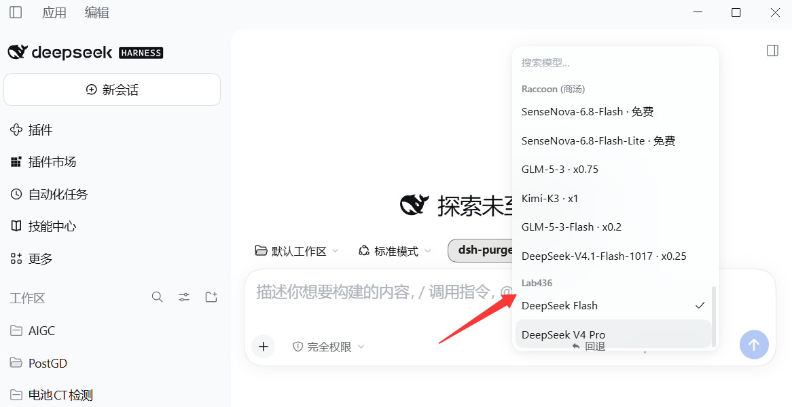

# 实验室 AI 网关 · DSH 插件

装上这个插件，就能在自己的 DeepSeek Harness（DSH）里用实验室的 DeepSeek 额度。
网关主机换了 IP 也不用管，插件会自己找。

## 它是怎么工作的

一句话：**管理员拿一个组账号连到 DeepSeek 官网，你的 DSH 通过网关借这个组账号说话**。
钱从组账号扣，网关记一笔是谁用的。



1. **管理员在官网充一个组账号**，整个组共用这一份额度。
2. **管理员给你发一把 `sk-lab-` 开头的 Key**，绑在你报的那个 IP 上。一人一把，别人的 Key 在你这台机器上用不了。
3. **你的 DSH 只连本机** `127.0.0.1:8801`，由插件去找真正的网关。所以网关换 IP、重启，你这边都不用改。
4. **网关核对 Key 和 IP**：这把 Key 是谁的、IP 对不对得上。都过了，就用组账号转发给官网，顺手记下这次用了多少 tokens。
5. **回答原路返回**，你这边看到的就是正常回复。管理员在「用量监控」里能看到你的名字和用量。

所以：不用自己充钱，不用填地址，也不用管网关在哪台机器上。但 **Key 别转给别人** ——
绑了 IP 的 Key 换台机器就用不了，没绑 IP 的谁拿到都能用，用量全算在你头上。

## 准备

> 只在校园网内可用。装之前先按第 1、2 步拿到一把 `sk-lab-` 开头的 Key。

- Windows，已装 DSH 0.2.1 或更新
- 连着校园网（不是手机热点、不是家里的宽带）

## 安装

### 第 1 步：查出自己的 IP

按 `Win + R`，输入 `cmd`，回车，会开一个黑窗口。
在黑窗口里**点右键**就是粘贴，把下面这行粘进去，回车：

```bat
ipconfig | findstr /i "IPv4"
```

会出来一到几行，找到 **`10.16` 开头**的那个地址：

```text
IPv4 地址 . . . . . . . . . . . . : 10.16.35.101
```

用鼠标选中这个地址（选中的地方会变白），按 `Ctrl + C` 或点右键复制。

注意：

- 只要 `10.16` 开头的。`127.0.0.1`、`192.168.x.x`、`172.x.x.x` 都不是校园网地址，别用。
- 出来好几行时，挑「以太网」或「WLAN / 无线局域网」那个，别挑 VMware、VirtualBox、WSL 的虚拟网卡。
- 上面的命令没输出，就直接敲 `ipconfig`，自己在结果里找「IPv4 地址」那一行。

### 第 2 步：把这三样发给管理员，拿到 Key

1. **姓名**
2. **邮箱**（或任何能认出你的标识，组里别重名）
3. **刚才查到的 IP**

管理员按这三样给你建账号，回你一个 `sk-lab-` 开头的 Key，**存下来，下一步要用**。

管理员说「不用绑 IP，直接给你」时，只发姓名和邮箱就行。

### 第 3 步：完全退出 DSH

托盘图标右键退出，任务管理器里也不该再有 DeepSeek Harness。
只点窗口右上角的 × 不算退出。

### 第 4 步：下载安装脚本，双击运行

[**点这里下载 LabAI-Setup.bat**](https://github.com/Deliver0/dsh-labai-gateway/releases/latest/download/LabAI-Setup.bat)

下载完双击它，按屏幕提示**粘贴第 2 步拿到的 Key，回车**。

- 提示「此文件不安全 / 未知发布者」→ 点「保留」→「仍要运行」。
- 脚本会自动下载插件，稍等一会儿；如果你的 DSH 还缺渠道插件，它会顺手装一个，可能要一两分钟。
- 链接打不开：打开 <https://github.com/Deliver0/dsh-labai-gateway> → 绿色 `Code` → `Download ZIP` → 解压 → 双击 `install.bat`。

### 第 5 步：等管理员点通过

安装脚本最后会显示：

```text
申请已提交，正在等审批
```

看到这行就告诉管理员「我装好了」，等管理员点通过。通过之后重新打开 DSH 就能用了。

### 第 6 步：在 DSH 里选模型

重新打开 DSH，新建对话，点模型选择，找到 **`Lab436`** 分组：



里面两个模型：

| 模型 | 什么时候用 |
| --- | --- |
| `DeepSeek Flash` | 日常对话、写代码、改文档。回答快，也便宜 |
| `DeepSeek V4 Pro` | 数学、逻辑、长链条推理。会先想一段再回答，慢一些、也贵一些 |

官方的模型说明：<https://api-docs.deepseek.com/zh-cn/quick_start/pricing>

> 你平时用的 `v4.1-flash` 就是这里的 `DeepSeek Flash`，同一个模型，换了个名字而已。

地址和 Key 插件已经配好了，不用自己填。

**确认真的在走实验室额度**：随便问一句，能正常回答就是通了；再让管理员在管理页看一眼，
「用量监控」里出现你的名字和调用次数，就说明走的是实验室额度。

**想用回自己原来的模型**：在模型选择里换回你原来的分组即可，两套互不影响。

有工具非让你填接口地址时：

```text
地址  http://127.0.0.1:8801/v1
Key   随便填一个，或留空
```

## 连不上了？

先打开 <http://127.0.0.1:8801/__labai/status>

- 有 `"ip": "10.16.x.x"` → 已经连上网关
  - `approval` 是 `pending` → 还没审批，继续等
  - `approval` 是 `active` 却还报错 → 多半是 IP 变了，见下一条
- `"ip": null` → 多半是没连校园网、网关主机没开机，或者它换到了新网段

**提示「这个 Key 不允许从 x.x.x.x 使用」**：你的 IP 变了。按第 1 步重新查一次，把新 IP 发给管理员。

想强制重新找一次网关：<http://127.0.0.1:8801/__labai/refresh>

还是不行就把 status 页面的截图发给管理员。**别自己改 DSH 里的地址，也别把 Key 转给别人。**

网关换 IP、重启之后，你这边什么都不用做。

## 卸载

双击插件目录里的 `uninstall.bat`，再重启一次 DSH。

---

发 Key、审批、看用量、停用成员这些只有管理员用得到，写在 `ADMIN.md`，普通用户不用看。
